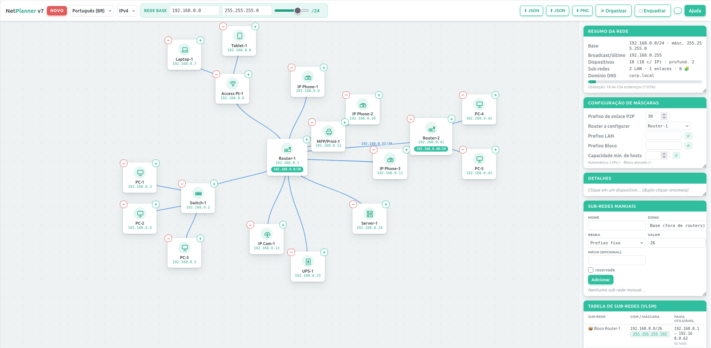

<div align="center">

# 🌐 NetPlanner

**Calculador visual de sub-redes IPv4/IPv6 com VLSM, topologia hierárquica e sumarização de rotas**
*Visual IPv4/IPv6 subnet calculator with VLSM, hierarchical topology and route summarization*

[](LICENSE)




🇧🇷 [Português](#-português) · 🇪🇸 [Español](#-español) · 🇬🇧 [English](#-english) · 💚 [Esperanto](#-esperanto)
🧩 [Linguagens e versões / Languages & versions](#-linguagens-e-versões--lenguajes-y-versiones--languages--versions--lingvoj-kaj-versioj)

</div>

---

## 🇧🇷 Português

### Sobre

O **NetPlanner** é uma aplicação web de arquivo único (`index.html`) para **planejar endereçamento IP visualmente**. Você desenha a topologia — routers, switches, access points, servidores, PCs, notebooks, tablets, telefones IP, câmeras IP, impressoras e nobreaks — e o NetPlanner calcula automaticamente as sub-redes com **VLSM**, os gateways, os enlaces ponto a ponto entre routers e os sumários de rota.

Não há servidor, build, instalação nem dependências externas: basta abrir o arquivo em um navegador moderno.

### Funcionalidades

- **Topologia hierárquica infinita** — botões **+** e **−** em cada nó para adicionar/remover dispositivos; **Shift + arrastar** sobre outro nó reenxerta o ramo inteiro.
- **IPv4 e IPv6** — seletor no topo; toda a aritmética de endereços usa **`BigInt` de 128 bits**, sem perda de precisão.
- **Rede base sincronizada** — IP, máscara (decimal pontuada) e slider de prefixo atualizam-se mutuamente; entradas inválidas são destacadas.
- **VLSM automático** — cada router recebe um bloco dimensionado pela demanda real de seus descendentes; o 1º IP útil de cada LAN vira o gateway; switches e APs consomem 1 IP de gerenciamento.
- **Enlaces P2P entre routers** — prefixo configurável (ex.: `/30`, `/31`, `/127`), exibido sobre as ligações no canvas.
- **Máscaras por router** — cartão *Configuração de máscaras* (prefixo da LAN, prefixo do bloco, capacidade mínima de hosts) ou clique no *chip de máscara* da tabela, aceitando `26`, `/26` ou `255.255.255.192`. O botão **↺** volta ao automático.
- **Sub-redes manuais** — regras próprias (prefixo fixo ou mínimo de hosts, início explícito, reservada), vinculadas a um router ou à base; o VLSM respeita esses blocos e **alerta sobreposições** e desalinhamentos.
- **Tabela de sub-redes (VLSM)** — CIDR, máscara, faixa utilizável e número de hosts.
- **Sumários de rota** — o menor prefixo que agrega as sub-redes internas de cada router, indicando cobertura exata ou sobra.
- **DNS / Hostnames** — domínio configurável (ex.: `corp.local`) e FQDNs gerados por dispositivo, com cópia para a área de transferência.
- **Resumo da rede** — base, broadcast, contagem de dispositivos, profundidade, sub-redes e barra de utilização.
- **Renomear** com duplo clique no próprio cartão ou pelo campo *Nome* em *Detalhes*.
- **Organizar** (layout automático) e **Enquadrar** (ajustar zoom); pan e zoom com mouse/roda.
- **Exportar/Importar** a topologia em **JSON** e exportar a imagem em **PNG**.
- **Tema claro/escuro** e **4 idiomas** (pt-BR, es, en, eo); preferências guardadas em `localStorage` (`np-theme`, `np-lang`).
- **Painéis redimensionáveis** com rolagem própria.

### Como usar

1. Baixe ou clone o repositório:
   ```bash
   git clone https://github.com/<seu-usuario>/netplanner.git
   cd netplanner
   ```
2. Abra `index.html` no navegador (duplo clique já funciona).
   Opcional, via servidor local:
   ```bash
   python3 -m http.server 8000   # depois acesse http://localhost:8000
   ```
3. Ao abrir, o app carrega um **exemplo demonstrativo**. Use **NOVO** para começar do zero.
4. Ajuste a **rede base**, adicione dispositivos com **+**, configure máscaras e acompanhe a tabela VLSM, os sumários e o DNS no painel da direita.
5. Salve com **⬇ JSON** e restaure com **⬆ JSON**; exporte o diagrama com **⬇ PNG**.

**Publicar no GitHub Pages:** *Settings → Pages → Deploy from a branch → `main` / `(root)`*. Como o `index.html` está na raiz, o app fica disponível em `https://<seu-usuario>.github.io/netplanner/`.

### Atalhos e gestos

| Ação | Gesto |
|---|---|
| Adicionar filho / remover ramo | botões **+** / **−** do nó |
| Reenxertar ramo | **Shift + arrastar** e soltar sobre outro nó |
| Renomear | **duplo clique** no nó |
| Mover o canvas | arrastar no fundo |
| Zoom | roda do mouse |

### Privacidade

Tudo roda localmente no navegador. Nenhum dado é enviado a servidores; só o tema e o idioma ficam no `localStorage`.

### Docker (opcional)

O NetPlanner **não precisa de Docker**: basta abrir o `index.html`. A imagem serve para quem quer hospedá-lo num servidor próprio ou numa rede interna.

```bash
docker run -d -p 8080:80 --name netplanner ghcr.io/cadunico/netplanner:latest
# ou, para construir a imagem a partir do código:
docker compose up -d --build
```

Depois acesse <http://localhost:8080> (app) e <http://localhost:8080/site.html> (página do projeto). A imagem é publicada automaticamente no GitHub Container Registry (`ghcr.io`) a cada nova release.

### Licença

Copyright © 2026 **Carlos Eduardo Mattos da Cruz**.
Distribuído sob a **GNU General Public License v3.0 ou (a seu critério) qualquer versão posterior** — `GPL-3.0-or-later`. Veja [LICENSE](LICENSE).

---

## 🇪🇸 Español

### Acerca de

**NetPlanner** es una aplicación web de un solo archivo (`index.html`) para **planificar el direccionamiento IP de forma visual**. Usted dibuja la topología —routers, conmutadores, puntos de acceso, servidores, PC, portátiles, tabletas, teléfonos IP, cámaras IP, impresoras y SAI— y NetPlanner calcula automáticamente las subredes con **VLSM**, las puertas de enlace, los enlaces punto a punto entre routers y los sumarios de ruta.

No hay servidor, compilación, instalación ni dependencias externas: basta con abrir el archivo en un navegador moderno.

### Funcionalidades

- **Topología jerárquica infinita** — botones **+** y **−** en cada nodo; **Shift + arrastrar** sobre otro nodo reinjerta la rama completa.
- **IPv4 e IPv6** — selector en la parte superior; toda la aritmética usa **`BigInt` de 128 bits**.
- **Red base sincronizada** — IP, máscara y deslizador de prefijo se actualizan entre sí; las entradas inválidas se resaltan.
- **VLSM automático** — cada router recibe un bloque dimensionado según la demanda real de sus descendientes; la 1.ª IP útil de cada LAN es la puerta de enlace; conmutadores y AP consumen 1 IP de gestión.
- **Enlaces P2P entre routers** — prefijo configurable (`/30`, `/31`, `/127`…), mostrado sobre las conexiones.
- **Máscaras por router** — tarjeta *Configuración de máscaras* o clic en el *chip de máscara* de la tabla (`26`, `/26` o `255.255.255.192`). **↺** vuelve al modo automático.
- **Subredes manuales** — reglas propias (prefijo fijo o mínimo de hosts, inicio explícito, reservada); el VLSM las respeta y **avisa de solapamientos** y desalineaciones.
- **Tabla de subredes (VLSM)** — CIDR, máscara, rango utilizable y hosts.
- **Sumarios de ruta** — el menor prefijo que agrega las subredes internas de cada router, con cobertura exacta o sobrante.
- **DNS / Nombres de host** — dominio configurable y FQDN por dispositivo, con copia al portapapeles.
- **Resumen de la red** con barra de utilización.
- **Renombrar** con doble clic o desde *Detalles*.
- **Organizar** y **Encuadrar**; desplazamiento y zoom con el ratón.
- **Exportar/Importar JSON** y **exportar PNG**.
- **Tema claro/oscuro** y **4 idiomas**; preferencias en `localStorage`.
- **Paneles redimensionables**.

### Cómo usar

1. Clone el repositorio:
   ```bash
   git clone https://github.com/<su-usuario>/netplanner.git
   ```
2. Abra `index.html` en el navegador (o sirva la carpeta con `python3 -m http.server 8000`).
3. Al abrir se carga un **ejemplo de demostración**; pulse **NUEVO** para empezar desde cero.
4. Ajuste la **red base**, añada dispositivos con **+** y revise la tabla VLSM, los sumarios y el DNS en el panel derecho.
5. Guarde con **⬇ JSON**, restaure con **⬆ JSON** y exporte el diagrama con **⬇ PNG**.

**GitHub Pages:** *Settings → Pages → Deploy from a branch → `main` / `(root)`*.

### Privacidad

Todo se ejecuta localmente en el navegador; no se envía ningún dato a servidores.

### Docker (opcional)

NetPlanner **no necesita Docker**: basta con abrir `index.html`. La imagen es para quien quiera alojarlo en un servidor propio o en una red interna.

```bash
docker run -d -p 8080:80 --name netplanner ghcr.io/cadunico/netplanner:latest
# o, para construir la imagen desde el código:
docker compose up -d --build
```

Luego abra <http://localhost:8080> (aplicación) y <http://localhost:8080/site.html> (página del proyecto). La imagen se publica automáticamente en GitHub Container Registry (`ghcr.io`) con cada nueva versión.

### Licencia

Copyright © 2026 **Carlos Eduardo Mattos da Cruz**.
Distribuido bajo la **GNU General Public License v3.0 o (a su elección) cualquier versión posterior** — `GPL-3.0-or-later`. Véase [LICENSE](LICENSE).

---

## 🇬🇧 English

### About

**NetPlanner** is a single-file web application (`index.html`) for **planning IP addressing visually**. You draw the topology — routers, switches, access points, servers, PCs, laptops, tablets, IP phones, IP cameras, printers and UPS units — and NetPlanner automatically computes **VLSM** subnets, gateways, point-to-point links between routers and route summaries.

No server, no build step, no install and no external dependencies: just open the file in a modern browser.

### Features

- **Unlimited hierarchical topology** — **+** and **−** buttons on every node; **Shift + drag** onto another node re-parents the whole branch.
- **IPv4 and IPv6** — toggle in the header; all address math uses **128-bit `BigInt`** arithmetic.
- **Synchronized base network** — IP, dotted-decimal mask and prefix slider update each other; invalid input is highlighted.
- **Automatic VLSM** — each router gets a block sized to the real demand of its descendants; the first usable IP of each LAN becomes the gateway; switches and APs take one management IP.
- **Router-to-router P2P links** — configurable prefix (`/30`, `/31`, `/127`…), drawn on the links.
- **Per-router masks** — *Mask configuration* card (LAN prefix, block prefix, minimum host capacity) or click the *mask chip* in the table, accepting `26`, `/26` or `255.255.255.192`. **↺** resets to automatic.
- **Manual subnets** — custom rules (fixed prefix or minimum hosts, explicit start, reserved) bound to a router or to the base; VLSM honours them and **warns about overlaps** and misalignment.
- **Subnet table (VLSM)** — CIDR, mask, usable range and host count.
- **Route summaries** — the shortest prefix aggregating each router's internal subnets, showing exact coverage or waste.
- **DNS / Hostnames** — configurable domain and per-device FQDNs, copy to clipboard.
- **Network summary** with a utilization bar.
- **Rename** by double-clicking a node or via *Details*.
- **Arrange** (auto-layout) and **Fit** (zoom to fit); pan and wheel zoom.
- **JSON export/import** and **PNG export**.
- **Light/dark theme** and **4 languages**; preferences stored in `localStorage` (`np-theme`, `np-lang`).
- **Resizable side panels**.

### Getting started

```bash
git clone https://github.com/<your-user>/netplanner.git
cd netplanner
# open index.html directly, or:
python3 -m http.server 8000   # then browse to http://localhost:8000
```

The app opens with a **demo topology**; press **NEW** to start from scratch. Save with **⬇ JSON**, restore with **⬆ JSON**, export the diagram with **⬇ PNG**.

**GitHub Pages:** *Settings → Pages → Deploy from a branch → `main` / `(root)`*.

### Privacy

Everything runs locally in your browser. No data leaves your machine.

### Docker (optional)

NetPlanner **does not need Docker**: just open `index.html`. The image is for anyone who wants to self-host it on their own server or internal network.

```bash
docker run -d -p 8080:80 --name netplanner ghcr.io/cadunico/netplanner:latest
# or, to build the image from source:
docker compose up -d --build
```

Then open <http://localhost:8080> (app) and <http://localhost:8080/site.html> (project page). The image is published automatically to GitHub Container Registry (`ghcr.io`) on every new release.

### License

Copyright © 2026 **Carlos Eduardo Mattos da Cruz**.
Released under the **GNU General Public License v3.0 or (at your option) any later version** — `GPL-3.0-or-later`. See [LICENSE](LICENSE).

---

## 💚 Esperanto

### Pri

**NetPlanner** estas unudosiera retaplikaĵo (`index.html`) por **vide plani IP-adresadon**. Vi desegnas la topologion — enkursigilojn, ŝaltilojn, alirpunktojn, servilojn, komputilojn, tekkomputilojn, tabulkomputilojn, IP-telefonojn, IP-kameraojn, presilojn kaj nerompeblajn elektrofontojn — kaj NetPlanner aŭtomate kalkulas **VLSM**-subretojn, kluzojn, punkto-al-punktajn ligojn inter enkursigiloj kaj itinerajn resumojn.

Neniu servilo, kompilado, instalado aŭ ekstera dependaĵo: simple malfermu la dosieron en moderna retumilo.

### Funkcioj

- **Senlima hierarkia topologio** — butonoj **+** kaj **−** ĉe ĉiu nodo; **Shift + treni** sur alian nodon transplantas la tutan branĉon.
- **IPv4 kaj IPv6** — elektilo supre; ĉiu adresa kalkulo uzas **128-bitan `BigInt`**.
- **Sinkronigita baza reto** — IP, masko kaj prefiksa ŝovilo ĝisdatigas unu la alian.
- **Aŭtomata VLSM** — ĉiu enkursigilo ricevas blokon laŭ la reala bezono de siaj posteuloj; la unua uzebla IP de ĉiu LAN estas la kluzo; ŝaltiloj kaj alirpunktoj uzas 1 administran IP.
- **P2P-ligoj inter enkursigiloj** — agordebla prefikso (`/30`, `/31`, `/127`…).
- **Maskoj por ĉiu enkursigilo** — karto *Agordo de maskoj* aŭ klako sur la *maska ĉipo* en la tabelo (`26`, `/26` aŭ `255.255.255.192`). **↺** revenigas al aŭtomata reĝimo.
- **Manaj subretoj** — propraj reguloj (fiksa prefikso aŭ minimuma nombro de gastigantoj, eksplicita komenco, rezervita); VLSM respektas ilin kaj **avertas pri interkovroj**.
- **Subreta tabelo (VLSM)**, **itineraj resumoj**, **DNS / gastigantnomoj** kun kopiado al la tondujo.
- **Retresumo** kun uzado-stango.
- **Renomi** per duobla klako.
- **Aranĝi** kaj **Enkadrigi**; movi kaj zomi per la muso.
- **Eksporti/importi JSON** kaj **eksporti PNG**.
- **Hela/malhela etoso** kaj **4 lingvoj** (pt-BR, es, en, eo).
- **Regrandigeblaj paneloj**.

### Kiel uzi

```bash
git clone https://github.com/<via-uzanto>/netplanner.git
cd netplanner
# malfermu index.html rekte, aŭ:
python3 -m http.server 8000
```

La aplikaĵo malfermiĝas kun **demonstra ekzemplo**; premu **NOVA** por komenci de nulo. Konservu per **⬇ JSON**, restarigu per **⬆ JSON**, eksportu la diagramon per **⬇ PNG**.

### Privateco

Ĉio funkcias loke en via retumilo; neniuj datumoj estas senditaj.

### Docker (nedeviga)

NetPlanner **ne bezonas Docker**: simple malfermu `index.html`. La bildo estas por tiuj, kiuj volas gastigi ĝin en propra servilo aŭ en interna reto.

```bash
docker run -d -p 8080:80 --name netplanner ghcr.io/cadunico/netplanner:latest
# aŭ, por konstrui la bildon el la fontkodo:
docker compose up -d --build
```

Poste malfermu <http://localhost:8080> (aplikaĵo) kaj <http://localhost:8080/site.html> (projekta paĝo). La bildo estas aŭtomate publikigata en GitHub Container Registry (`ghcr.io`) ĉe ĉiu nova eldono.

### Permesilo

Kopirajto © 2026 **Carlos Eduardo Mattos da Cruz**.
Eldonita laŭ la **GNU General Public License v3.0 aŭ (laŭ via elekto) iu ajn posta versio** — `GPL-3.0-or-later`. Vidu [LICENSE](LICENSE).

---

## 🧩 Linguagens e versões / Lenguajes y versiones / Languages & versions / Lingvoj kaj versioj

Mapeamento obtido por análise do código-fonte de `index.html` (~880 linhas, 1 bloco `<style>`, 1 bloco `<script>`, sem bibliotecas externas).

| Linguagem / Tecnologia | Versão / Especificação | Onde é usada | Recursos que definem a versão mínima |
|---|---|---|---|
| **HTML** | HTML5 (WHATWG Living Standard) | Estrutura da página, formulários, janela modal de ajuda, `<output>`, `input type=range` | `<!DOCTYPE html>`, `data-*`, `<output>` |
| **CSS** | CSS3 + **CSS Color Module Level 5** | Tema claro/escuro, layout, cartões | Custom properties (`--var`), **Grid**, Flexbox, `gap`, `inset`, `accent-color`, **`color-mix()`** |
| **JavaScript** | **ECMAScript 2020 (ES11)** | Toda a lógica: VLSM, IPv4/IPv6, i18n, canvas, import/export | **`BigInt`** e literais `123n`, `?.` (optional chaining), `??` (nullish coalescing), `flatMap` (ES2019), arrow functions, `const/let`, template literals, spread `...` |
| **SVG** | SVG 1.1 (inline) | Ícones e ligações da topologia, base da exportação PNG | `createElementNS`, namespace `http://www.w3.org/2000/svg` |
| **JSON** | RFC 8259 / ECMA-404 | Formato de exportação/importação da topologia | `JSON.stringify` / `JSON.parse` |

**APIs Web utilizadas:** DOM, Pointer Events, Canvas 2D (`getContext("2d")`, `drawImage`, `toDataURL`), Blob + download por âncora, `FileReader.readAsText`, Clipboard API (`navigator.clipboard.writeText`), Web Storage (`localStorage`).

### Navegadores suportados (mínimo)

O requisito mais recente é `color-mix()`; o JavaScript exige ES2020 (`BigInt`).

| Navegador | Versão mínima |
|---|---|
| Chrome / Edge / Opera | 111+ |
| Firefox | 113+ |
| Safari (macOS / iOS) | 16.2+ |

### Como o GitHub classifica o repositório

O [GitHub Linguist](https://github.com/github-linguist/linguist) classifica por extensão de arquivo. Como CSS e JavaScript estão **embutidos** em `index.html`, a barra de linguagens do GitHub mostrará **HTML 100%**. O arquivo [`.gitattributes`](.gitattributes) garante essa detecção e exclui `docs/` das estatísticas.

---

<div align="center">

Feito com 💚 por **Carlos Eduardo Mattos da Cruz** · `GPL-3.0-or-later`

</div>
